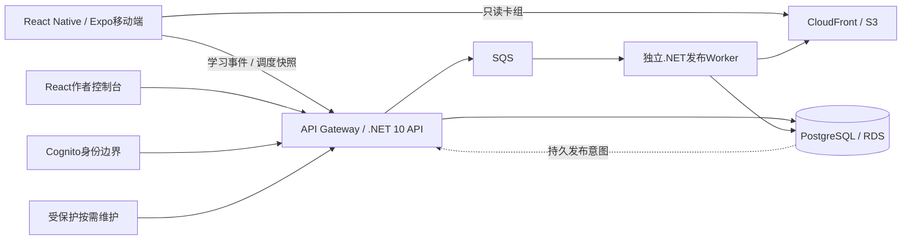

# DeveloperCards / RecallSmith 产品与系统设计

资料日期：2026-11-13。面向简历生成、项目介绍及技术面试。本轮已完成代码、本地集成验证和独立复审，尚未部署。实现证据见[交付记录](../reports/2026-11-13-architecture-hardening.md)，不能写成已在生产验证。

## 产品目标与核心交互

DeveloperCards 是以主动回忆和间隔复习为核心的双语学习产品，包含 React Native 移动端及 React 作者控制台。当前 AWS SAA-C03 内容以共享知识卡组织，一张卡可服务多个题目及领域。379 张卡、四领域119/76/143/41的数量来自2026-11-09内容发布回执；本轮保留原内容、UID及学习记录，未重新测量学习效果。

卡片按用途/机制、条件辨析、组合应用划分学习任务；正面给判断条件，背面展示结论、因果解释、易错边界、必答自评点和先修卡入口。教学内容支持英文及简体中文，领域导航和先修下钻帮助学习者建立知识关系。FSRS调度及离线内容让已安装卡组可在断网时继续学习；联网后同步学习事件与完整调度快照。

内容制作区分原题需求与技术事实：原题提供业务场景，AWS官方资料提供技术依据。格式、字段、引用及依赖检查由本地工具完成；语义与教学质量需要独立审查，不能由Schema或测试数量替代。AI作者、AI QA及自动接受的已提交配置保持关闭，不能把本轮实现写成云端AI自动生产已启用。

## 系统组成与技术选择

采用模块化单体API和独立发布Worker，沿用现有部署单元。CDN承担不可变内容分发，数据库保存作者库存、发布权威状态与服务端学习状态，SQS传递可重复唤醒消息。没有引入微服务、Redis、RDS Proxy、Kubernetes或新的常驻服务。

| 层次 | 使用技术 | 负责的事情 |
| --- | --- | --- |
| 移动端 | TypeScript、React19、React Native0.81、Expo54、Hermes、Zustand、AsyncStorage、Expo FileSystem、FSRS | 离线内容、学习交互、调度状态、待同步事件和登录生命周期 |
| 控制台 | React19、TypeScript、Vite、React Query、Cognito PKCE | 编辑/导入、卡组管理、受控发布与交付状态 |
| API/Worker | C#、.NET10、AWS Lambda、Npgsql、SQS | 鉴权、事务、幂等同步、内容发布、故障恢复 |
| 数据/分发 | PostgreSQL、RDS、S3、CloudFront | 权威业务状态、不可变构建与可重算manifest |
| 基础设施/交付 | Terraform、GitHub Actions、OIDC、哈希校验与既有smoke/回滚流程 | 可审查配置、无长期CI AWS凭证的常规交付 |
| 验证 | Vitest、TypeScript、xUnit、Testcontainers PostgreSQL、本地脚本 | 契约、并发、故障注入、权限及构建门禁 |

版本以源码锁文件为准；上述技术列表不表示每项能力都在本轮新建。

## 数据权威与一致性

设备已落盘且未获服务器ACK的eventId是待同步事实。服务端按eventId幂等接收；跨设备调度采用现有合并规则。完整FSRS状态属于持久快照，当前事件表不能单独重建全部状态，备份必须包括user_progress。

PostgreSQL的live_build_id与成功发布任务决定线上版本；S3内容文件不可变，manifest根据当前数据库指针重算。数据库与SQS/S3不使用分布式事务，通过持久意图、租约、幂等消费与对账恢复跨系统失败。不宣称端到端exactly-once。

## 本轮优化设计与实现边界

### 发布和交付恢复

普通发布在SQS响应不确定时保留任务身份，返回可查询的未确认状态，不把PROCESSING或SUCCESS降为FAILED。任务与投递意图同事务落库；重复请求复用身份，异内容同键冲突。短租约约束重复发送，Worker仍核验generation、收据及内容快照。

SUCCESS表示构建及数据库指针已提交，manifest交付独立记录。交付失败可以重试且不回退成功状态；旧任务重放按当前指针恢复，旧版缺少交付记录的成功任务也有有界恢复路径。新增自动扫描默认关闭，按需运行与费用验收分别放行。

### 账号删除和设备隔离

数据库删除事务建立持久屏障，并与所有用户数据写入共享按sub的序列化边界。屏障提交后，旧JWT、其他设备同步及迟到订阅回调不能重建该sub的数据。屏障和审计记录限制为必要字段，第三方未完成删除保留needs_attention，不能随保留清理静默消失。

移动端持久保存服务器删除、身份删除和本地清理阶段，重启后继续；身份删除失败时暂停正常同步。待删A账号与当前B账号的身份需要核对，避免误删B。普通退出保留未同步数据，明确删号才按归属清理。

### 离线队列和旧原生包兼容

队列满时拒绝新增保存确认，保留旧eventId。评分重试复用已有pendingRating；匿名收养把eventId归属持久化，部分ACK或崩溃后继续处理剩余，不能被另一账号认领。

旧2.1.0内嵌读取器不认识新增归属语义，因此这一优化要求新原生基线2.1.1/build26，禁止以纯2.1.0 OTA放行。本地构建门禁绑定冻结源码、同次Xcode实际Hermes bundle、签名IPA和runtime，并校验production更新频道。当前缺少已审查Podfile.lock，真实原生发布门禁保持关闭；商店及设备验收仍为外部放行条件。

### 内容契约与学习revision

C#、控制台及移动端共享契约和golden样例；教学字段、标签、先修UID经过Markdown/JSON导入、发布hash和下载解析。preview、普通发布、受控发布和Worker均执行先修存在性、自环/环路、删除引用及官方领域任务检查，独立于AI开关。

未知教学schema安全回退，不覆盖上一份有效安装。标签单独变化进入hash；旧无字段及已有teaching+tags的摘要兼容保留。展示、翻译及标签变化不重置学习掌握度；英文核心判断、英文教学或先修变化继续递增学习revision。Schema只证明结构，未重新审核379张卡语义。

### 数据库及权限安全

生产连接使用VerifyFull并验证主机名和官方RDS CA；显式require/disable/拼写错误在生产失败关闭。API与Worker构建包带相同CA字节，不能依赖总返回true的证书回调。

运行角色只具备明确业务DML，不能改schema、安全触发器、删除屏障或不可变证据。独立维护登录通过现有函数的专用数字版本按需迁移，凭证由所有者私密直调载荷传入，不写入普通部署角色可读的版本配置；创建和调用绑定已审ZIP的CodeSha256。数据库权威回滚函数校验成功构建、摘要、当前指针、generation和动作记录，不能仅靠会话变量跳过发布检查。公网迁移入口在隔离模式关闭；生产切换仍需维护窗口验收。

### 超时、容量和成本

在线调用共用不超过25秒的预算，连接、SQL及SDK调用接收取消信号；Worker及迁移保留独立时限。廉价health仅证明存活，数据库就绪检查走受保护按需路径，读取schema且不做DDL。

同步模块已移除自定义access token磁盘副本，通过SDK初始化/刷新注入内存令牌，并尽力清理遗留键。SDK自身仍可能用AsyncStorage保存会话；未引入Keychain，也不宣称完成凭据加密。

保留API512MB/并发40、Worker615秒/并发2、SQS可见性3700秒/batch1。40×PG_MAX+2×PG_MAX仅估算活动执行，空闲Lambda环境和多个池仍占连接，不能当作总连接上限。没有新增规格、实例、调度、指标维度或付费API；最终按量账单变化仍需同工作量证据，本轮未查询账单。

## 简历生成使用规则

对已发布产品，可引用仓库既有发布回执中明确的产品和技术事实，并保留日期与适用范围。本轮优化在生产验收前使用“设计并实现、完成本地测试和独立源码复审”等表述；不写“已在线防止事故”“零丢失”“零成本”“企业级高可用”或新的线上性能百分比。

个人贡献、AI辅助范围和生产发布职责应由项目所有者按实际情况补充。历史性能、恢复演练和测试数量不能移作本轮新测结果。真实记忆效果、并发容量、RTO/RPO及费用没有因为代码检查通过而重新验证。

## 最终本地验证

核心架构代码提交：`a1fb7b238c7970483018405200aef92b0b175e8f`。CI补充修复截至`30ae95cd04360ec2cc5c4476bfecf634024fd174`，只改传递依赖锁、测试夹具和IAM计划清单；API/Worker及控制台源码树保持相同。依赖更新后重跑了3207项移动端测试，以及39项ingest、345项evals测试和审计。

| 检查 | 实际结果与范围 |
| --- | --- |
| 后端 | 3275项通过，0失败、0跳过；包含真实本地PostgreSQL/TLS及并发、权限和故障恢复测试 |
| 移动端 | 2441单元＋765集成＋1 smoke，共3207项通过，类型检查通过；原生SDK/签名边界使用明确标注的替身 |
| 控制台 | 1820项通过，lint及生产构建通过；最终前端源码树与被测版本相同 |
| 脚本 | 基础设施287、CD脚本234、维护工具10、发布治理4项通过 |
| 构建 | iOS/Android Metro导出及source map包检查通过；Linux ARM64 API/Worker ZIP、CA及程序集/迁移回读通过 |
| 复审 | 发布、删除、TLS、队列、内容契约、权限和超时均有独立冻结源码复审；通过范围为源码及已有本地证据 |

没有执行生产迁移、部署、OTA、商店提交或调度启用。真实签名、设备、线上IAM/RDS、容量、费用和学习效果未因此验收。

## 关键源码入口

| 设计 | 主要入口 |
| --- | --- |
| 请求、认证、Agent边界 | `src_C/Vpc/VpcFunction.cs`、`JwtVerifier.cs`、`AgentClientPolicy.cs` |
| 发布与恢复 | `Publish.cs`、`PublishDelivery.cs`、`PublishJobProcessor.cs`、`ManifestBuilder.cs` |
| 删除屏障 | `052_account_deletion_barrier.sql`、`AccountDeletion.cs`、`accountDeletionPending.ts` |
| 离线同步与会话 | `mobile/src/sync/progressSync.ts`、`authStore.ts`、`freshToken.ts` |
| 内容契约与增量 | `contracts/content-v1/`、`CandidateDeckValidation.cs`、`DeckDiff.cs`、`ContentArtifactsGenerator.cs`、`deckRepository.ts` |
| TLS、维护与回滚 | `PgConnectionSecurity.cs`、`MaintenanceFunction.cs`、`scripts/db/`、`056_authoritative_content_rollback.sql` |
| 超时和发布记录 | `RequestBudget.cs`、`Readiness.cs`、`release-record.py`、`check-wave-cost.py` |
| 原生构建 | `nativeBuildProvenance.cjs`、`observeNativeBundle.cjs`、`queueOwnershipRollout.cjs`、`mobile/app.config.js` |
