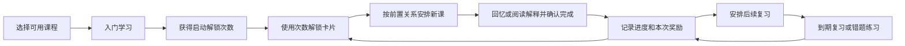

# DeveloperCards 产品设计

更新日期：2026-11-14。工程及基础设施中保留 RecallSmith 名称，本文与 DeveloperCards 指同一项目。

DeveloperCards 是面向开发者及 AWS 学习者的 iOS 闪卡产品。用户先学习少量卡片，获得解锁次数，再取得后续卡片，并按间隔重复计划复习。当前可用内容是一个包含 379 张卡的 AWS Architect Basics 双语课程。

## 1. 当前交付范围

| 项目 | 当前状态 |
| --- | --- |
| 移动端发布基线 | iOS 2.1.0 / build 25，Expo runtimeVersion 为 2.1.0 |
| 最近一次已验证 OTA | 更新组 `dd2ad2ee-7ca5-4cf7-9165-9fe9215e8975`；源提交 `1b3605c61191ca158866060cf637ca6a82a1d606` |
| 发布内容 | 前置关系优先的发卡及新课排课；继承此前中文自查、账号摘要、双语搜索、学习位置恢复等修复 |
| 可学习卡包 | `aws-saa-fundamentals`，379 张，公开下载、英中双语 |
| 其他课程 | 发布快照中 AWS Associate Architect、Claude Developer Foundations 为 Coming Soon；历史 C# 卡包已退役 |
| 商业化 | 已有 Premium 订阅和权益技术路径；当前课程免费，FAQ 明确尚无可解锁的 Premium 内容 |
| 发布约束 | 按维护者当前决定仅做兼容现有运行时的 OTA；原生模块或不兼容存储升级需要另行安排二进制发布 |

上述版本依据保留的发布回读，不表示重新验证了 App Store 当前可下载状态。后台、基础设施和 AI 服务的当前运行开关未在本次文档整理中重新核查。

## 2. 产品问题与目标

学习者面对长篇技术文档时，需要把服务机制变成可回忆的判断；只记服务名称又难以应对条件变化。普通题库也容易让人只记答案，而不理解为什么。

产品把学习单位设为“一个有用途的判断及其关键原因”，用双语解释降低理解成本，用间隔重复安排再次回忆。解锁和开包提供阶段性奖励，课程顺序负责保持知识依赖。

| 目标 | 设计对应 | 可观察的完成条件 |
| --- | --- | --- |
| 能理解卡片 | 具体场景、直接结论、机制解释、必要易错提醒 | 能用自己的话解释条件为什么导向结论 |
| 能完成一次短学习 | 默认最多 5 张的常规会话，按可用任务缩短 | 有清晰起点、逐卡进度和结算反馈 |
| 愿意继续学习 | 学习奖励、收集进度、开包揭示 | 完成当前任务后有明确的下一步 |
| 复习已有知识 | FSRS 调度、错题练习、领域视图 | 能找到到期卡及薄弱主题 |
| 在网络不稳定时继续 | 完整课程缓存、本地进度、稍后同步 | 已下载内容可离线学习及解锁 |

这些是产品目标与验收方法。当前没有证据把它们写成留存率、考试通过率或记忆效果的实际提升。

## 3. 学习与奖励闭环

### 新用户

1. 选择已开放课程；未上线课程展示 Coming Soon，不能开始学习。
2. 入门课使用既有的 5 张基础卡，通知权限可以跳过。
3. 入门完成或首次进入课程时提供启动额度，由课程标记去重，避免同一启动奖励重复发放。
4. 使用额度解锁新卡，通过开包动画查看获得内容，再进入课程学习。

### 学习奖励与持续推进

| 规则 | 当前实现 |
| --- | --- |
| 首次完成新卡 | 满足评分及资格条件时，为该卡包赚取 1 次解锁；同一卡有去重账本 |
| 清完当日到期卡 | 为该卡包提供每日最多 1 次清空奖励 |
| 启动额度 | 基础额度为 5 次，受入门、课程和账户标记约束 |
| 钱包 | 按账户和卡包区分；可用额度上限 60，溢出储备上限 5 |
| 批量解锁 | 界面提供单张或最多 5 张；内部提交上限 10 张，只按实际得到的卡数扣次 |
| AWS 课程衔接 | 已取得卡都学过、可用与储备额度耗尽、课程仍有新卡时，可衔接下一批最多 5 次，不要求等待次日 |
| 通用防断档规则 | 其他卡包在无新课、无到期任务、无额度时，有每日 1 次的保底逻辑；不表示当前已有其他上线卡包 |

抽卡次数不出售。当前 AWS 课程按依赖关系推进，稀有度不改变下一张的发放概率；通用随机抽卡及保底代码为其他卡包保留。课程衔接补给也属于现有机制，因此不能把这个产品描述为“必须付费或等到第二天才能继续”。

## 4. 前置卡、发卡和学习顺序

379 张卡中有 85 张记录了前置要求，共 117 条前置关系。原有编号中有 14 条关系的基础卡排在进阶卡后面，涉及 12 张卡。

当前规则：

- 发卡先处理前置关系；同批获得基础卡和进阶卡时，基础卡在前。
- 旧账号已经拥有或学过进阶卡，却缺基础卡时，后续解锁优先补齐基础。
- 基础卡也要通过解锁获得，未获得时仍隐藏题面和答案。
- 排新课时优先已拥有、尚未学过的基础卡；完成首次学习即可继续，无需等待 Mastered。
- 已有卡不回收；缺少先修不新增学习硬锁，避免旧账号被卡在无任务、无奖励的状态。
- 卡号、UID、revision 和正文保持稳定；学习顺序与图鉴编号分别承担依赖安排与身份定位。

到期复习、全量复习和用户明确选定的错题练习沿用各自规则。更新前已经开始的会话保留当前位置，新优先级在后续选卡时生效。

## 5. 卡片与答题设计

每张卡保留明确问题、直接答案、因果解释，以及真正影响选择的易错条件。必要术语要解释用途。Easy、Rare、Legend 分别承担基础机制、条件辨析与组合应用；层级不作为学习效果证明。

| 卡面部分 | 用户用途 |
| --- | --- |
| 题面 | 在隐藏答案时尝试回忆或作出判断 |
| 答案 | 直接核对结论 |
| 考点 | 理解决定结论的机制 |
| 答题要点 | 自查是否覆盖了本卡所问内容 |
| 易错提醒 | 识别会改变选择的条件或竞争方案 |
| 前置先修 | 找到相关基础卡；未解锁时保留锁定状态 |
| 来源 | 在入口可用时查看官方依据 |

当前 379 张卡共有 757 条中文自查要点。这是既有卡片内的内容本地化，不是 757 张卡、新卡包或 757 次自动评分。自查标记使用中性项目符号，避免把“列出答案”误读成“系统已判定答对”。

普通问答卡由学习者自评；选择题能力支持选项、信心和判定反馈。代码支持选择题不代表当前 AWS 包的全部卡都是选择题，也没有运行中的大模型替用户判普通问答。

中文自查随 OTA 内置：仅当 UID 和英文要点逐项匹配时使用；有效服务器中文优先。内容变化而无法匹配时显示明确回退，避免套用旧译文。

## 6. 功能与页面

| 页面或流程 | 主要任务 | 状态与边界 |
| --- | --- | --- |
| Welcome / 课程选择 | 建立学习目标和考试日期 | 显示 Available、Coming Soon、Unavailable；离线保留基础课程入口 |
| Home | 判断今天做什么、继续课程或会话 | 展示待学、到期和学习进度；读取失败与没有任务分开 |
| SessionCard | 学新卡、复习、选择题作答 | 隐藏/展示答案；先修跳转返回保留原位置；本地保存未完成会话 |
| SessionSummary | 查看完成情况和奖励 | 展示已结算结果，返回或重开不重新发奖 |
| Draw / DrawCeremony | 使用已获得次数、查看新卡 | 发卡扣次先于展示；动画有可用性降级，动画展示不作为授卡凭据 |
| DrawResult | 查看刚取得的卡并继续学习 | 说明基础优先，进入已有课程的学习队列 |
| Library | 查找和浏览个人卡片 | 英中题面、卡号、UID 搜索；中文偏好影响预览；卡片区分已得与锁定 |
| CardDetail | 阅读完整卡面、来源和先修 | 未取得卡不展示正文；New、Learning、Mastered 是应用状态 |
| MistakeBook | 集中练习错题及相关卡 | 明确的读取错误与重试；指定练习不自动扩展到未取得卡 |
| DomainProgress | 查看领域进度及进入练习 | 领域是导航分类，同一知识卡可以共享，不复制卡片数量 |
| Me / Profile / Settings | 账户、学习摘要、课程、设置 | 切换账号刷新并使旧请求失效；读失败不能展示假零 |
| 登录 / 注册 / 找回密码 | 绑定账号和恢复访问 | 访客可本地学习；登录增加云端备份及关联能力 |
| Paywall | 展示订阅和恢复购买 | 现有订阅技术路径；当前没有 Premium 内容解锁收益可供声称 |
| MyReports / 问题反馈 | 查看自己的反馈或进入登录 | 反馈能力受功能开关控制；有页面不表示所有入口当前开启 |
| FAQ / Support / Privacy | 理解规则并获得帮助 | 外链失败提示和重试；调试页面不作为公开产品功能 |

## 7. 离线、恢复与账户体验

完整课程首次下载后可离线使用。本地学习先完成，账号同步稍后进行；访客模式的数据保存在设备中。登录后的学习进度、持有卡和额度有同步路径，但各类状态采用不同合并规则，不能统一称为无损同步。

未完成会话的恢复范围是同一设备、同一账户、同一天、相同卡包版本及学习参数，且进度和持有集合仍匹配。保存内容包括当前卡、展开状态、已完成数、选择题选项与判定、会话标识和已经结算的奖励展示。恢复不重新评分或结算。条件变化时重新安排任务。

这项能力是本机学习位置恢复，不能描述为跨设备无缝续学。存储失败时提示重试，不把旧位置静默覆盖；账户变化时旧数据展示和异步请求都需失效。

## 8. 商业与产品约束

当前可用 AWS 基础课程免费。Premium、购买恢复、服务端权益和受保护下载属于已经实现的商业化基础设施；尚无付费转化或收入证据。当前不售卖抽卡次数。

产品判断还需要持续验证：学习者是否理解卡片、是否愿意次日返回、能否迁移到原题、前置排序是否降低学习中断。本次没有重新测量这些指标。

| 指标 | 当前能支持的陈述 |
| --- | --- |
| 课程规模 | 1 个可学习课程，379 张卡，117 条前置关系 |
| 本地化 | 757 条中文自查要点有独立审查记录 |
| 最近移动端验证 | 3,144 项测试通过；另外 153 项独立复审测试与 29 项文案检查存在重叠，不累计成新增总数 |
| 奖励与恢复 | 合成账号模拟器流程验证了锁定、扣次、奖励、版本往返和关闭重开 |
| 下载交付 | 最近 OTA 的生产清单与实际下载包 hash 匹配 |
| 用户增长、收入、记忆及通过率 | 本次没有可引用测量，不填数字 |

## 9. 简历可提炼的产品能力

可以强调课程依赖与激励机制的共同设计、离线学习、双语教学、短会话与恢复、错误和空态的区分，以及在现有运行时中完成兼容发布。

适合作为项目介绍的英文：

> DeveloperCards is an iOS flashcard learning product with a React administration console and an AWS backend. It combines bilingual AWS content, spaced repetition and earned card unlocks, with offline study and account-based synchronisation.

工程亮点、可选英文经历条目及指标边界见 [系统设计与简历素材](developercards-system-design-2026-11-14.md)。

## 10. 依据

- [前置关系 OTA 验证](https://github.com/ChuanQiao1128/DeveloperCards/blob/b2a14d6641643ea728068049404fff07e4030a8d/exports/prerequisite-ota-210-20261114/verification.json)：最近发布、3,144 项测试、四个模拟器流程及交付校验。
- [学习体验 OTA 发布记录](https://github.com/ChuanQiao1128/DeveloperCards/blob/b2a14d6641643ea728068049404fff07e4030a8d/exports/mobile-ux-ota-210-20261114/README.md)：中文自查、学习位置恢复及前一轮兼容修复。
- [产品 FAQ](https://github.com/ChuanQiao1128/DeveloperCards/blob/b2a14d6641643ea728068049404fff07e4030a8d/mobile/src/content/faq.ts)：当前课程、奖励、离线和 Premium 产品规则。
- [移动端路由](https://github.com/ChuanQiao1128/DeveloperCards/blob/b2a14d6641643ea728068049404fff07e4030a8d/mobile/src/navigation/types.ts)：已注册页面及参数。
- [卡包钱包](https://github.com/ChuanQiao1128/DeveloperCards/blob/b2a14d6641643ea728068049404fff07e4030a8d/mobile/src/features/gacha/rewards/deckWallet.ts)、[防断档规则](https://github.com/ChuanQiao1128/DeveloperCards/blob/b2a14d6641643ea728068049404fff07e4030a8d/mobile/src/features/gacha/rewards/economyFloor.ts)、[评分奖励](https://github.com/ChuanQiao1128/DeveloperCards/blob/b2a14d6641643ea728068049404fff07e4030a8d/mobile/src/features/gacha/rewards/sessionRewards.ts)：额度、课程衔接、保底和评分奖励。
- [前置发卡](https://github.com/ChuanQiao1128/DeveloperCards/blob/b2a14d6641643ea728068049404fff07e4030a8d/mobile/src/features/gacha/draw/orderedAcquisition.ts)、[学习排课](https://github.com/ChuanQiao1128/DeveloperCards/blob/b2a14d6641643ea728068049404fff07e4030a8d/mobile/src/features/gacha/planner/sessionPlanner.ts)：前置发卡与新课排序。
- [学习位置检查点](https://github.com/ChuanQiao1128/DeveloperCards/blob/b2a14d6641643ea728068049404fff07e4030a8d/mobile/src/features/gacha/session/sessionCheckpoint.ts)、[中文自查匹配](https://github.com/ChuanQiao1128/DeveloperCards/blob/b2a14d6641643ea728068049404fff07e4030a8d/mobile/src/content/checklistLocalization.ts)：本地恢复与自查本地化边界。
