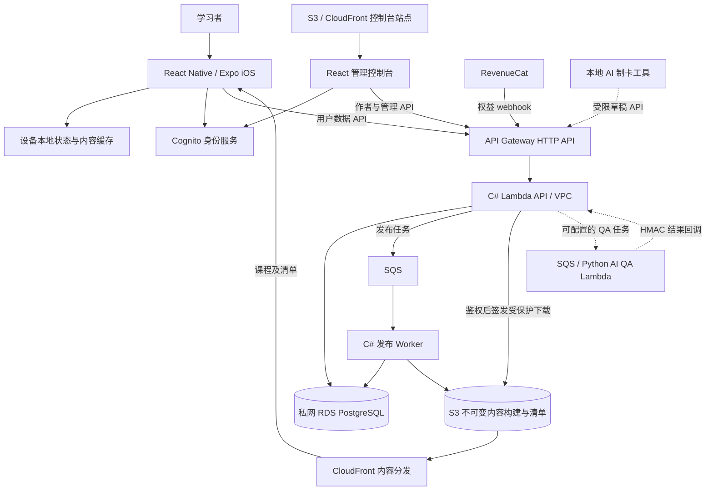
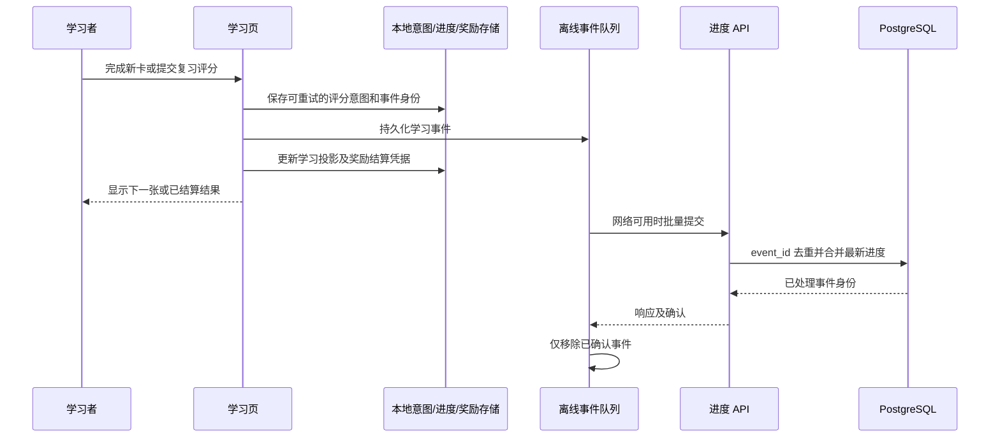
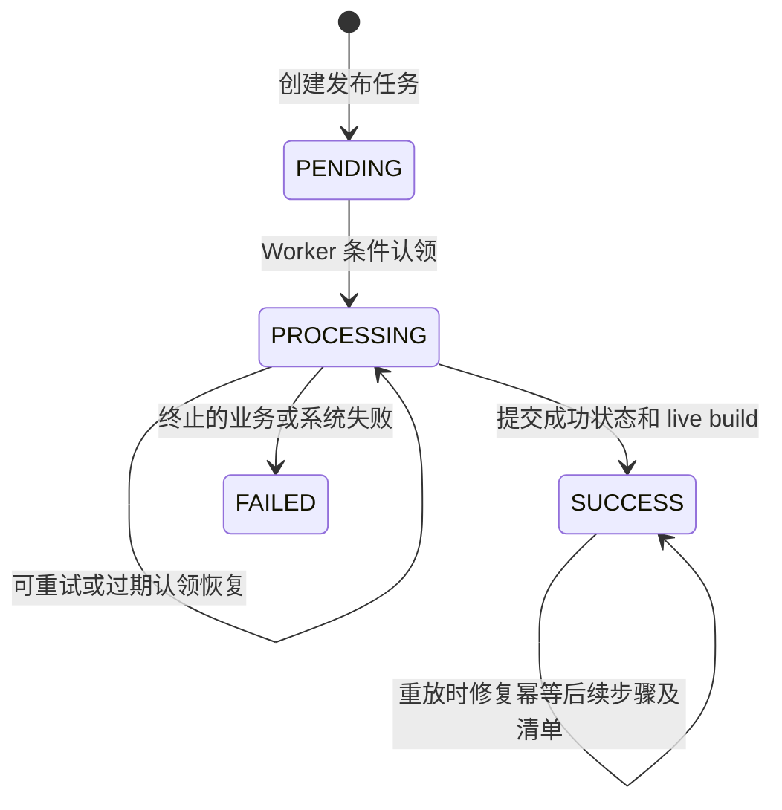

# DeveloperCards 系统设计与简历素材

更新日期：2026-11-14。产品工程也使用 RecallSmith 名称。产品流程见 [产品设计](/Users/qc/.codex/worktrees/mobile-ux-ota-210-20261114/draw-motion-20261113/docs/showcase/developercards-product-design-2026-11-14.md)。

## 1. 版本与证据范围

| 范围 | 依据与状态 |
| --- | --- |
| 本地项目快照 | `b90ab5a9`，位于 `codex/mobile-ux-ota-210-20261114` |
| 当前已验证移动端发布 | iOS runtime `2.1.0` / build `25`；最近 OTA 源 `1b3605c61191ca158866060cf637ca6a82a1d606` |
| OTA 更新组 | `dd2ad2ee-7ca5-4cf7-9165-9fe9215e8975`，2026-11-13 19:25:34 UTC，即新西兰 2026-11-14 08:25:34 |
| 交付验证 | 生产清单与 CDN 下载均成功；6,040,300 字节，SHA-256 与实际上传包一致 |
| 后台与基础设施 | 下面描述当前源码中的实现；本次没有重新核查云端部署版本、实际配置或 AI 开关 |
| 历史资料 | 旧性能、运行观察和恢复演练保留原日期、版本与测量条件 |

当前移动端采用兼容既有二进制的 OTA。另一分支的 2.1.1 学习事件队列所有权和账号删除恢复升级没有回移，不能当作现有 2.1.0 的已上线能力。

## 2. 架构

学习内容和个人写入采用不同路径。公开课程可由 CDN 缓存，手机可以离线读取；个人进度、管理操作和权益检查经过身份校验与数据库。核心 API、发布 Worker 和管理控制台组成个人项目可维护的部署面，不把每个业务模块拆成独立服务。

图中的 AI QA 是已实现、可配置的路径；图示不表示它当前在生产开启。当前 RDS 配置为单可用区，不能由这张架构图推导出跨可用区高可用。

## 3. 技术栈及职责

| 层 | 当前源码技术 | 职责 |
| --- | --- | --- |
| 移动端 | TypeScript、React 19.1、React Native 0.81.5、Expo SDK 54、Hermes | 学习交互、导航、内容与本地数据 |
| 客户端状态及存储 | Zustand、AsyncStorage、Expo FileSystem | 会话、账户/卡包分区、进度、队列、卡包文件 |
| 交互动画 | Reanimated 4、Gesture Handler、Skia、Expo Haptics / Audio | 开包、卡片揭示、反馈及降级路径 |
| 管理控制台 | React 19、TypeScript、Vite 7、React Query、React Router、Tailwind | 编写、导入、审核、发布及管理 |
| API 与发布 Worker | C# / .NET 10、AWS Lambda、Npgsql 10 | 权限、事务写入、发布状态和后台消费 |
| 数据 | PostgreSQL 17.9 / RDS | 内容、用户进度、发布任务、权益、运营记录 |
| 身份与订阅 | Cognito / Amplify、RevenueCat | 登录、用户及管理权限、订阅权益 |
| 分发与基础设施 | S3、CloudFront、API Gateway、SQS、Terraform | 内容和站点分发、请求入口、异步任务、配置管理 |
| 交付与观测 | GitHub Actions OIDC、EAS Update、CloudWatch、Sentry | 审批、验证、发布、故障观察 |
| 内容与 AI 工具 | 本地 TypeScript MCP、Python 检查/评估、受控 AWS 内容发布 | 来源处理、制卡、质量检查、证据及发布约束 |

.NET 10 是仓库当前项目目标，不借此断言所有正在运行的 Lambda 已经部署这份源码。动画实现也不等于测得所有设备稳定 60 FPS。

## 4. 模块和数据模型

### 客户端边界

- `features/gacha/planner` 和 `review` 计算可学卡、复习时间及评分后进度。
- `features/gacha/draw` 负责资格、发卡、持有集合、历史和展示所需数据；动画读取发卡结果。
- `features/gacha/rewards` 维护按账户与卡包区分的额度、首次学习账本和结算凭据。
- `content` 解析清单、缓存课程、校验及更新内容；`StableUid` 定位卡片，`Revision` 表示内容修订。
- `auth/sessionBoundary` 和 `review/storage` 提供身份边界；账号或页面变化使旧异步读取失效。
- `sessionCheckpoint` 保存本设备未完成会话，`sync` 同步账号数据。检查点与云端进度承担不同职责。

### 服务端数据

| 数据 | 主要键或身份 | 设计作用 |
| --- | --- | --- |
| Deck / Card | deck slug、stable UID、revision | 保留学习身份，同时支持内容修订与幂等导入 |
| Publish job / Build | job ID、build/version、状态 | 条件认领、重试判断、不可变构建及 live 指针 |
| `user_progress_events` | event ID，关联用户、卡包、卡片 | 重复提交去重并保留学习事件 |
| `user_progress` | 用户、卡包、卡片 | 客户端查询的最新进度投影 |
| 订阅权益 | 用户、权益状态、事件及时间信息 | webhook 去重和时序更新、受保护下载资格 |
| 草稿 / QA / 来源 / 发布凭据 | 草稿、运行、来源与卡片版本身份 | 内容审核、问题定位、阻止过期版本发布 |
| PostgreSQL 每日统计 | 日期及统计维度 | 当前运营汇总；Snowflake 和旧 analytics outbox 已退役 |

本地键使用账户分区，并进一步区分卡包。持有卡、FSRS 进度、奖励账本、内容缓存和会话位置分别保存，不能把所有状态视为一份可任意覆盖的 JSON。

## 5. 一次评分：本地响应与同步

评分链路复用 `eventId` 和持久化待处理意图，避免重试时重新生成一次独立评分。账户检查、写锁、奖励凭据和恢复检查限制并发或中断后的重复操作。AsyncStorage 多个键之间不是数据库事务，因此不能描述为任意崩溃下的全局原子结算。

客户端把事件按批提交，当前实现最多 25 条/批、20 轮，确认后删除。服务端以 `event_id` 去重；同一批次内按事件时间及 event ID 选择最新事件，跨批次按时间戳合并，同时间戳后到者覆盖。相关写入通过单条包含 CTE 的 SQL 完成。传输可重试，处理逻辑幂等，不能写成网络 exactly-once。

FSRS 使用本地纯函数的 FSRS-5 记忆模型。调度适配器保存记忆状态、处理旧进度重建、首次学习、Again 短期重学及考试日期边界。远程开关关闭 FSRS 时可回到既有阶梯调度。

### 已知同步取舍

- 当前 2.1.0 每个队列分区最多 3,000 条，超限丢弃最旧事件并记录本地计数；不是无限或绝不丢失的日志。
- 历史匿名待同步事件由下一次登录账号接收，共享设备可能发生归属误判。新的所有权格式升级未通过本轮 OTA 发布。
- 持有卡采用集合并集；额度和保底状态采用带客户端时间戳的 LWW 快照。多个设备同时离线花额度时可能恢复部分已花额度，尚未改成授予/花费事件账本。
- 本地 compare-and-set 保护网络往返期间的新写入，但不消除上述跨设备快照合并限制。

## 6. 奖励发卡与前置关系

AWS Basics 采用前置优先的课程发卡。处理顺序为：捕获账户及内容版本，进入持有状态边界，重新读取资格和余额，校验完整依赖图，计算发卡顺序及指纹，保存取得的卡并扣除实际卡数。

发卡遍历先处理已持有卡的缺失基础，再依照原课程编号遍历其余依赖。缺失引用或循环在授卡和扣奖前拒绝。新课规划只返回当前范围中已持有、尚未学过的卡，优先基础；预览和明确指定练习不会因为图中存在别的卡而获得额外访问权限。

| 情况 | 行为 |
| --- | --- |
| 基础卡尚未取得 | 正文仍锁定，后续解锁优先补齐 |
| 同批得到基础和进阶 | 基础先发，按实际得到数量扣次 |
| 基础完成首次学习 | 可继续进阶，不要求 Mastered |
| 老账号只持有进阶 | 保留持有与学习入口，不增加学习硬锁 |
| 老记录或部分预览缺少依赖 | 学习规划降级为可用范围，发卡仍要求完整有效图 |

历史记录保留原 `selectionPolicy: ordered-v1` 及既有结构。新增算法在原有不透明 `sortingHash` 字符串中使用 `prerequisites-v1:` 前缀，绑定 UID、编号、revision 及前置关系；当前代码分别重放旧随机、旧课程顺序和新依赖顺序。旧 OTA 保留这类记录，但不能正确重放新算法，仅报告不匹配。

发卡与钱包使用单设备串行写入和账户资格围栏；两份状态不构成跨设备账务事务。现有崩溃恢复优先保留已发卡片，不能夸大成完整金融账本。当前解锁次数不出售。

## 7. 学习位置与内容分发

### 学习检查点

会话位置按设备、账户、卡包保存。恢复前核对自然日、卡包版本、学习模式/参数、完整进度签名及持有集合；不匹配时重新规划。检查点保存当前 UID、展开状态、选择题反馈、完成数、会话及已结算结果。

保存与清理共用每个键的串行队列，防止完成后晚到的保存让旧会话复活。恢复展示不会再次调用评分或发奖。前置详情往返保留当前会话，账号边界变化使旧操作失效。这不是跨设备会话同步。

### 内容读取

清单通过 ETag 条件请求刷新，内存、AsyncStorage 元数据和文件缓存共同减少重复下载。课程按版本获取完整 JSON 或适用的增量包，安装过程包含校验和临时文件处理；已有缓存支持完整下载后的离线学习与解锁。

公开内容走 S3/CloudFront，Premium 下载资格由服务端权益控制并使用签名 URL。中文自查在本轮采用只读本地化表，UID 和英文要点完全匹配才使用，完整服务器中文优先。其余卡面字段、卡包版本和进度未被该本地化表写回。

当前 2.1.0 解析器没有继承另一个 2.1.1 分支对未知 teaching 结构的全部防护，不应根据未来版本的测试替它宣称这些边界已经解决。

## 8. 管理、导入和异步发布

管理控制台通过 Cognito 授权码/PKCE 登录。移动与控制台身份配置分开；网关检查 token issuer/audience，后端继续检查角色及卡包权限。卡片编辑有版本条件，冲突返回 409；稳定 UID 导入使用事务 upsert，只在内容变化时更新相应版本。

API 先保存发布任务，再发送 SQS；发送失败有任务失败处理。Worker 条件认领任务，构建并上传不可变内容，把成功状态与 live build 变更一起提交，再处理清单及后续副作用。SQS 的重复投递由任务状态和幂等处理应对，不能称为队列 exactly-once。

数据库和 S3/SQS 不共享一个事务。成功提交后清单失败需要重放修复；发布结果指标为 best-effort 事件，不能当作完整成功率账本。若需要保证数据库任务与队列交付的一致性，可另行评估事务 outbox；当前不能说已经实现该方案。

## 9. 身份、权益和内容 AI

### 权益及安全

RevenueCat webhook 采用固定时间的共享 bearer token 比较，按事件去重并依时间更新权益；它不是 HMAC 协议。内部机器回调另有 HMAC。控制台静态分发配置包含 CSP、HSTS 和 frame denial，S3 采用私有源站及 CloudFront 访问控制。

账号删除有现有 API 和客户端路径；本次没有把另一个分支的持久化删除恢复升级当成已上线。访问控制、最小权限和 CI 安全检查有代码及历史证据，不代表做过完整渗透测试或能保证没有漏洞。

### AI 和内容生产边界

| 路径 | 已实现能力 | 状态与限制 |
| --- | --- | --- |
| 本地制卡 MCP | 来源读取、相似卡检索、导入规则 lint、草稿提交 | 引文须与读取过的来源匹配；引用匹配不证明事实正确 |
| 普通草稿与审核 | 草稿队列、审核、拒绝、修改与发布约束 | Agent 令牌受限，不能把其草稿权限当发布权限 |
| AWS 受控内容发布 | 授权 Codex 审查身份、逐卡版本/正文 hash、凭据和过期围栏 | 存在授权 Codex 审查策略，不能声称每张卡都经过人工逐卡批准 |
| 云端 AI QA | SQS 到 VPC 外 Python Lambda，再 HMAC 回调 | 历史记录为关闭或 dry_run；本次未核查生产开关，不写成持续开启的运营能力 |
| 来源监测及自动化 | 来源检查、webhook、运营记录等服务代码 | 定义、历史运行与当前启用状态分别说明 |
| C# 内容 workbench | 有界执行、schema、凭据及恢复的本地 canary | 文档排除了生产检索/发布及远程协调适配器，不能称完整线上 RAG 平台 |

AWS 制卡以官方技术资料作为事实来源，原题只约束要教的场景。逐卡事实、双语、教学、迁移和整题支撑分别验收。当前 379 张发布包与历史 347/363 张里程碑分开记账，也不能凭卡数宣称全部原题支撑或真实学习效果已经测得。

## 10. 交付、观测与可靠性取舍

Terraform 管理 API、数据库、队列、分发和观测设施。GitHub Actions CD 定义 OIDC 身份、生产审批、构建物 checksum、基线 smoke、恢复点及回滚；CI 运行前端/移动/后端测试和相关安全、基础设施检查。它与移动端 EAS OTA 是不同发布路径。

OTA 脚本要求 production 环境，检查必要公开配置名称，按 `runtimeVersion: appVersion` 发布。新 JS 必须兼容旧二进制和存储读写格式；不能仅降低版本号绕过兼容边界。最近发布回读了 runtime、源提交、更新清单及实际 CDN 资源 hash。生产日志和异常路径使用 CloudWatch/Sentry；本次 OTA 的 Sentry source map 上传结果为 `skipped-no-token`，未影响发布完成。

| 当前取舍 | 代价或后续条件 |
| --- | --- |
| 私网单 AZ RDS PostgreSQL，配置 db.t4g.micro、加密和 14 天备份 | 运维面和成本较小；没有多 AZ 自动故障转移保证 |
| 单个核心 API 加独立发布 Worker | 适合个人维护；更多负载或团队边界出现时再评估拆分 |
| 公共内容 CDN、本地缓存和用户 API 分路 | 内容可缓存、可离线；版本和权限切换需要严格校验 |
| 学习事件与余额采用不同同步模型 | 事件可幂等重试；余额快照仍有离线并发合并损失 |
| 旧原生基线继续 OTA | 可交付兼容 JS 修复；原生依赖及不兼容协议升级被延后 |
| 按任务状态实现幂等后台处理 | 需要面对跨数据库、队列、对象存储的中断窗口与修复 |

下一阶段的设计工作应由观测触发：跨设备额度正确性要求提高时改事件账本；发布任务漏投递要求提高时评估事务 outbox；可用性目标或数据库资源达到阈值时评估 Multi-AZ、代理及容量。当前没有容量测试支撑具体 QPS、DAU 或 SLA 承诺。

## 11. 可引用指标与简历边界

| 数字或事实 | 能说明什么 | 不能说明什么 |
| --- | --- | --- |
| 当前 379 张卡、117 条前置关系 | 已交付课程及依赖图的工程规模 | 题库全覆盖、考试通过率或用户规模 |
| 757 条中文自查 | 审核过的本地化要点数量 | 新卡数、自动评分数量或用户评价数 |
| 3,144 项移动端测试 | 最近冻结代码的 2,373 unit、770 integration、1 smoke 通过；另有 typecheck | 不是 3,144 个新写测试，不代表覆盖率百分比，也不是整个仓库测试总数 |
| 153 项独立检查、四个 Maestro 流程 | 独立代码核验及合成账号模拟器场景 | 不能与全套测试简单相加，也不等于全部真机或实际用户验收 |
| 历史进度摄入往返 4 到 1、handler p50 37.1 到 18.8 ms | `docs/low-latency-plan.md` 的历史内部合成请求优化记录 | 旧 v44 / .NET 8 / 128 MB、batch 1、改后 n=100；不能当成当前端到端延迟或用户体验提升 49% |
| 历史 DR 演练 RTO 27 分钟、RPO 8 分 03 秒 | 一次保留记录的恢复演练 | 不是持续 RTO/RPO 保证 |
| 2026-10-26 运行观察 | 小规模运行服务的有限 CloudWatch 样本 | 请求含探针/回调；不是用户数、负载容量或完整成功率 |

项目开始时间、付费人数、MAU、DAU、留存率、收入和个人工作时长没有在本次整理中核定。简历不要填猜测值。

## 12. 简历条目候选

仓库把它描述为一人维护的个人项目。可使用“独立设计与维护”，并根据本人实际承担的工作选用下面 3 或 4 条。开发过程使用 AI 编程与内容辅助，不宜描述成所有代码和内容均手工完成，也不虚构团队管理职责。

项目名称：DeveloperCards。简要技术栈可选 React Native / TypeScript、React、C# / .NET、PostgreSQL、AWS、Terraform。

### 移动端或全栈岗位

- Designed and shipped a React Native/Expo iOS learning app with bilingual AWS content, FSRS review scheduling, offline study and prerequisite-aware earned card unlocks.
- Implemented acquisition and learning rules across 379 cards and 117 prerequisite links; validated the release against a 3,144-test mobile suite and simulator restart/fallback scenarios while preserving existing collections and reward accounting.
- Built local review persistence and idempotent event synchronisation to C#/PostgreSQL, with retryable rating intents, account-scoped storage and timestamp-based progress merging.
- Built a React administration console and .NET 10/AWS backend with versioned editing, stable-UID imports and idempotent SQS publishing to immutable S3/CloudFront builds.

### 云端交付或 AI 工程岗位的可选替换

- Established approval-gated delivery with Terraform and GitHub Actions OIDC, artifact verification, smoke checks and rollback, alongside runtime-compatible Expo OTA updates.
- Implemented source-grounded drafting tools, review queues, evaluation controls and auditable release receipts for technical learning content.

历史性能条目只在准备好解释测量条件时使用：

> Reduced progress-ingestion database round trips from four to one; an internal benchmark recorded handler p50 falling from 37.1 ms to 18.8 ms under its original test conditions.

不要把“支持订阅”改写成已经获得收入，把“有 AI QA”改写成无人值守生产，把“幂等”改写成任意故障下 exactly-once，或把用户认可卡片易懂改写成已测量学习提升。

## 13. 源码与发布证据索引

- [最近热更新证据](/Users/qc/.codex/worktrees/mobile-ux-ota-210-20261114/draw-motion-20261113/exports/prerequisite-ota-210-20261114/verification.json)：当前 runtime、测试、模拟器与线上交付。
- [项目总览](/Users/qc/.codex/worktrees/mobile-ux-ota-210-20261114/draw-motion-20261113/README.md)：个人项目、组成及退役分析管道。
- [移动端依赖](/Users/qc/.codex/worktrees/mobile-ux-ota-210-20261114/draw-motion-20261113/mobile/package.json)：Expo、React Native、状态及动画技术。
- [API 项目](/Users/qc/.codex/worktrees/mobile-ux-ota-210-20261114/draw-motion-20261113/src_C/Vpc/RecallSmith.Lambda.Vpc.csproj)：当前 C# 项目目标与包。
- [Worker 项目](/Users/qc/.codex/worktrees/mobile-ux-ota-210-20261114/draw-motion-20261113/src_C/Worker/RecallSmith.Lambda.Worker.csproj)：SQS 消费者项目。
- [进度同步客户端](/Users/qc/.codex/worktrees/mobile-ux-ota-210-20261114/draw-motion-20261113/mobile/src/sync/progressSync.ts)：批量、确认、上限及匿名归属取舍。
- [服务端进度摄入](/Users/qc/.codex/worktrees/mobile-ux-ota-210-20261114/draw-motion-20261113/src_C/Vpc/Runtime/ProgressEvents.cs)：event ID 去重、单语句合并与最新事件规则。
- [持有与余额同步](/Users/qc/.codex/worktrees/mobile-ux-ota-210-20261114/draw-motion-20261113/mobile/src/sync/drawStateSync.ts)：并集、LWW 和离线并发限制。
- [评分恢复意图](/Users/qc/.codex/worktrees/mobile-ux-ota-210-20261114/draw-motion-20261113/mobile/src/review/pendingRating.ts)：可重试评分持久化。
- [FSRS 实现](/Users/qc/.codex/worktrees/mobile-ux-ota-210-20261114/draw-motion-20261113/mobile/src/review/fsrs.ts)：本地 FSRS-5 纯函数。
- [前置图遍历](/Users/qc/.codex/worktrees/mobile-ux-ota-210-20261114/draw-motion-20261113/mobile/src/features/gacha/draw/prerequisiteOrder.ts)：严格发卡图与宽容学习范围。
- [授卡提交及重放](/Users/qc/.codex/worktrees/mobile-ux-ota-210-20261114/draw-motion-20261113/mobile/src/features/gacha/draw/drawCommit.ts)：持有提交、诊断历史及算法指纹。
- [额度扣除边界](/Users/qc/.codex/worktrees/mobile-ux-ota-210-20261114/draw-motion-20261113/mobile/src/features/gacha/draw/acquireDraw.ts)：账户、内容、额度和串行执行。
- [会话位置恢复](/Users/qc/.codex/worktrees/mobile-ux-ota-210-20261114/draw-motion-20261113/mobile/src/features/gacha/session/sessionCheckpoint.ts)：恢复条件及串行保存/清理。
- [内容仓库](/Users/qc/.codex/worktrees/mobile-ux-ota-210-20261114/draw-motion-20261113/mobile/src/content/deckRepository.ts)：清单、版本、缓存和安装。
- [编辑与导入](/Users/qc/.codex/worktrees/mobile-ux-ota-210-20261114/draw-motion-20261113/src_C/Vpc/Authoring/CardsImport.cs)：stable UID、事务与内容变更。
- [发布入口](/Users/qc/.codex/worktrees/mobile-ux-ota-210-20261114/draw-motion-20261113/src_C/Vpc/Authoring/Publish.cs)：任务创建、发布门禁及排队。
- [发布仓库](/Users/qc/.codex/worktrees/mobile-ux-ota-210-20261114/draw-motion-20261113/src_C/Worker/Repositories/JobRepository.cs)：条件认领与状态提交。
- [发布指标恢复契约](/Users/qc/.codex/worktrees/mobile-ux-ota-210-20261114/draw-motion-20261113/docs/qa/career-readiness-20261026/publish-metrics.md)：重放、清单修复及指标偏差。
- [AWS 受控发布](/Users/qc/.codex/worktrees/mobile-ux-ota-210-20261114/draw-motion-20261113/src_C/Vpc/Authoring/ContentRelease.cs)：审查身份、逐卡 hash 和版本围栏。
- [本地制卡 MCP](/Users/qc/.codex/worktrees/mobile-ux-ota-210-20261114/draw-motion-20261113/tools/mcp-server/README.md)：受限工具及来源处理。
- [AI QA](/Users/qc/.codex/worktrees/mobile-ux-ota-210-20261114/draw-motion-20261113/services/ai-qa/README.md)：实现结构与启用条件。
- [有界内容工作台](/Users/qc/.codex/worktrees/mobile-ux-ota-210-20261114/draw-motion-20261113/tools/content-workbench/README.md)：canary 能力与排除范围。
- [基础设施数据库](/Users/qc/.codex/worktrees/mobile-ux-ota-210-20261114/draw-motion-20261113/infra/modules/data/rds.tf)：私网、单 AZ、实例及备份配置。
- [控制台安全响应头](/Users/qc/.codex/worktrees/mobile-ux-ota-210-20261114/draw-motion-20261113/infra/modules/edge/security_headers.tf)：CSP、HSTS 和 frame denial。
- [持续交付](/Users/qc/.codex/worktrees/mobile-ux-ota-210-20261114/draw-motion-20261113/.github/workflows/cd.yml)：OIDC、审批、验证及回滚定义。
- [OTA 发布脚本](/Users/qc/.codex/worktrees/mobile-ux-ota-210-20261114/draw-motion-20261113/mobile/scripts/release/ota.sh)：production 环境、runtime 及 source map 结果。
- [历史性能记录](/Users/qc/.codex/worktrees/mobile-ux-ota-210-20261114/draw-motion-20261113/docs/low-latency-plan.md)：历史内部 benchmark 和测量边界。
- [恢复演练记录](/Users/qc/.codex/worktrees/mobile-ux-ota-210-20261114/draw-motion-20261113/docs/ops/dr-restore-drill-2026-10-04.md)：一次演练的端到端 RTO 与 RPO，不作为持续保证。
- [历史运行观察](/Users/qc/.codex/worktrees/mobile-ux-ota-210-20261114/draw-motion-20261113/docs/qa/career-readiness-20261026/operations.md)：有限运行样本及未核定事项。
