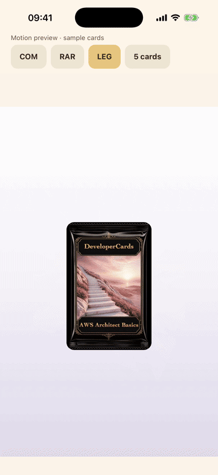

# 抽卡新设计：实体开封与重点翻面

本文件记录合并前的设计验证快照。发布状态以同目录后续发布回执为准。

以 Emil Kowalski 的 animate-expo / choreograph 为指导，保留现有卡包与卡背，取消三次蓄力和镜头震动，用重叠的撕封、出卡、落桌承接一次揭晓。批量结果直接呈现，最高稀有卡获得一次聚焦；“View all cards”立即返回完整结果。

- [五张批量抽卡录屏](batch-preview.mp4)
- [设计与时间线](../../docs/design/draw-motion-20261113.md)
- [验证范围与源码指纹](verification.json)

3,213 项移动端测试、类型检查及 iOS/Android 导出通过。独立复核已关闭翻牌阴影、卡片尺寸和动态按钮导致的位置跳变。原生预览使用样例卡和单独 App 标识，运行于 iPhone 17 Pro / iOS 26.5 模拟器；它复用兼容的旧模拟器原生壳，不是已签名的 2.1.1 发布包。真机触觉、声音同步与帧性能仍需设备验收。

完整原始录屏、测试日志和早期失败记录保留在本地交付目录，未全部加入版本库。
