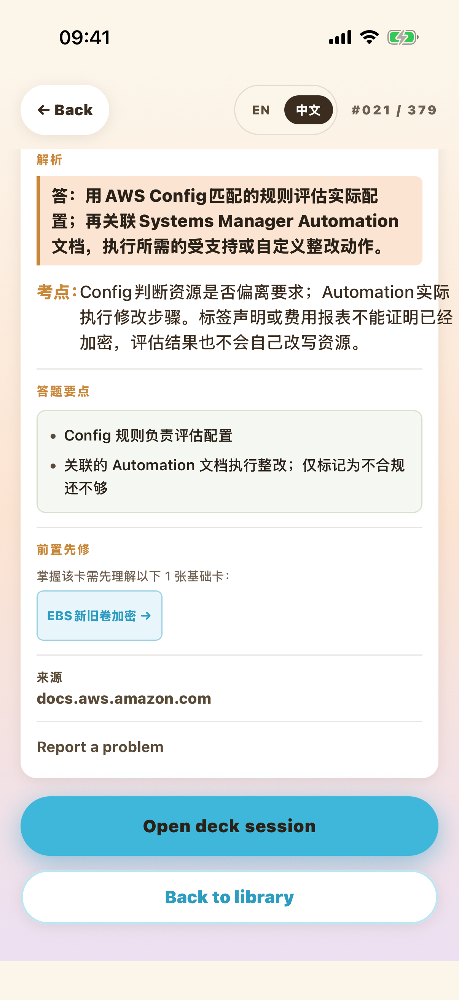

# 2.1.0 热更新兼容修复

已准备并验证，尚未发布。遵照用户“Apple 开发者账户未续费，暂时只热更新”的要求，本分支从线上现有2.1.0源头回移修复，未修改原生版本、依赖或学习事件队列格式。

生产基线已从 EAS production channel 只读核实：2026-11-13 07:03:44 UTC，组 `d4ad156d-4f0b-453d-a552-8f9c50b7b857`，源提交 `ce9ea8c116502d4724cc8ba05cd2258d8b3e57b2`，runtime `2.1.0`，iOS25，clean，environment production。见 production-before.json。

## 用户可以看到的变化

- 中文答题要点、中性自查标记、可点先修与返回原学习位置。
- 图鉴双语搜索及中文预览、课程可用状态、账号摘要和错题读取错误与重试、详情及返回按钮改进。
- 关闭再打开后，同一天和相同学习上下文下恢复未完成的位置、答案展开与选择题反馈；恢复动作不重算评分或奖励。
- 原来一个379张卡的卡包继续使用。757条是这379张卡里的自查要点，已审核译文直接随OTA携带。只有UID和英文要点逐项完全匹配时才使用内置中文；完整服务器中文优先。原缓存卡包字节、UID、revision、顺序、进度均不写回。无需先部署后端才能显示本批中文。

## 验证结果

- 最终 typecheck、2352 unit、769 integration、1 smoke，共3122项通过。见 evidence/mobile-full.txt。
- 独立兼容审查PASS，27项重点测试通过。见 review.md。
- 38批译文哈希、379张/757点与冻结输入全部一致。生成器：mobile/scripts/build-checklist-localizations.py。
- 原生2.1.0测试壳、独立测试App、原公开缓存卡包和合成访客；4个Maestro流程全部通过。先学到第3/5张并展开，停止进程，切回旧线上JS，再停止并切回修复JS：sessionId/UID/2-of-5/展开状态与余额均保持；最后完成，余额7→7→7→10，已学20→20→20→23，检查点清除。
- 旧缓存卡包SHA始终是 c994e567628dbe7d9bcf1372ae8cb4ee610873fcf95196e637a15cb6fcca6e0b，内容中中文要点数一直0；实际界面出现中文证明来自OTA本地化而非替换卡包。
- production环境本地Hermes导出通过；OTA dry-run通过，未发布。打包遇到替换依赖软链接后的本工作树Watchman旧索引；只重建本工作树索引后通过，产品代码未因此修改。Sentry dry-run未取token，skipped-no-token并非发布结果。

## 发布边界

本分支保留线上旧reader/writer；2.1.1的队列所有权及账号删除恢复升级留在原完整修复分支，不能改成2.1.0版本号后发布。本分支无需Apple新二进制。

模拟器手工切换JS证明源代码与存储往返，不等于真实EAS下载、更新选择或AppStore签名embedded回退验收。本轮未测真机、真实账号、购买、推送。最终发布状态以verification.json和EAS更新组回读为准。

